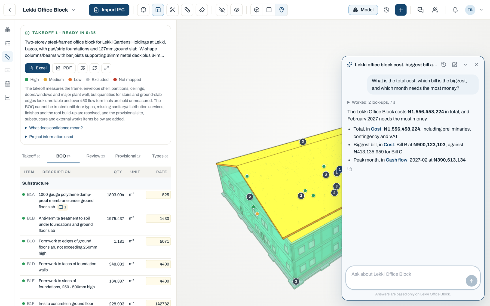
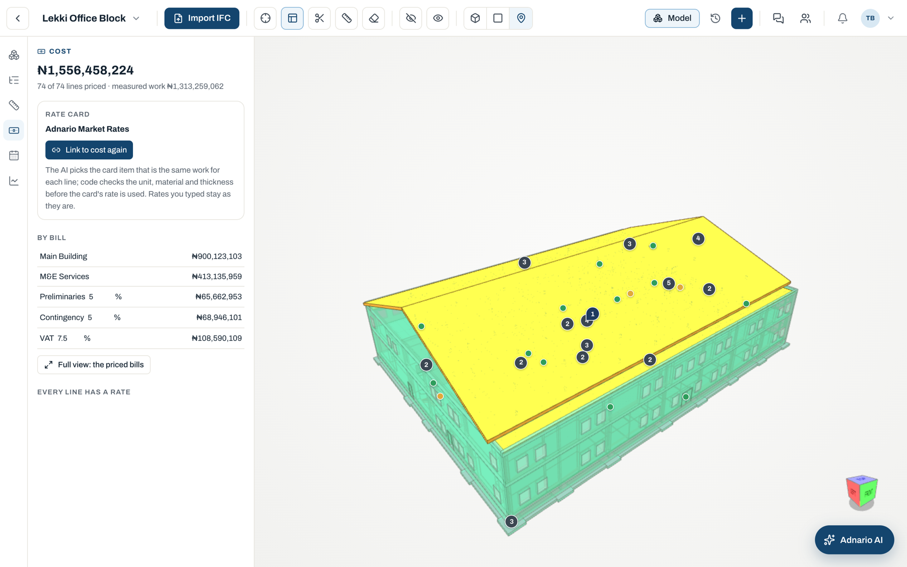
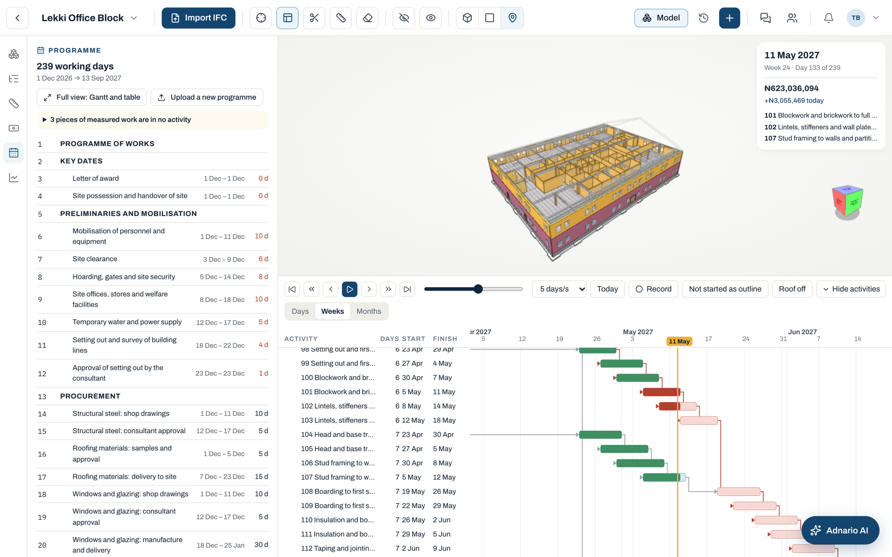
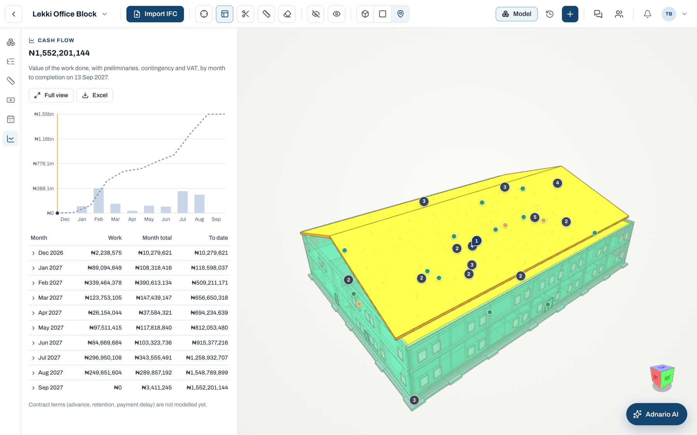

# Adnario Estimate

**A week of quantity surveying, done in under an hour.** Adnario Estimate turns a building's design model into a measured, priced Bill of Quantities, matches it to the contractor's programme of works and forecasts the cash flow month by month, with the architect, the quantity surveyor, the contractor and the client all working on the same project.



## The problem

Before a building goes up, someone has to say what it will cost. In Nigeria and across emerging markets, that work is still done by hand. A quantity surveyor receives the architect's drawings and spends days, often a full week, measuring every wall, column, slab, door and window into a spreadsheet, wording each line the way their firm writes a Bill of Quantities, and pricing it from rates kept in yet another spreadsheet.

Then the design changes, and much of that week starts again.

The contractor's programme of works arrives as a separate PDF. Before anyone can say how much money is needed in March or what is being built in week 12, someone has to match its activities to the BOQ, line by line, by hand. The client, who is paying for all of it, usually sees none of this until a document is emailed to them.

Every hand-over between the architect, the QS, the contractor and the client is a copy, a retype and a chance for the numbers to drift apart. Tenders go out late, estimates go out with gaps nobody noticed, and cost overruns are discovered on site instead of on the drawing board.

## What changes with Adnario Estimate

The QS uploads the design model and has a complete first draft in under an hour: every quantity measured, every line worded in the firm's style, every rate linked to the firm's rate card, the work placed under the contractor's programme, and a monthly cash flow. On the demo buildings, the whole chain from upload to cash flow runs in about ten minutes of machine time. The QS's days go into checking and judgement instead of counting and typing.

Every number can be checked. Click a BOQ line and its elements light up in the 3D model. Anything the system is not sure about becomes a review question for the QS, never a silent guess, and anything the design leaves out (excavation depth, hardcore, the fence, drainage, the septic tank) is proposed as a provisional item for the QS to accept or reject.

## One project, every party

- **Architects** upload their IFC models (architecture, structure, services). A new export becomes the next version, and everyone can compare the two in 3D to see what was added, removed or changed.
- **Quantity surveyors** run the takeoff, generate the BOQ, link it to cost, answer the review questions and export the BOQ to Excel and PDF. They keep full control: every quantity, description and rate can be edited.
- **Contractors and site teams** see the programme of works played as a 4D simulation over the model, week by week, without the quantities or the money.
- **Clients** see the total, the priced bills and the month-by-month cash flow, without the firm's rate cards.
- **Everyone** can comment on the project, on a single element in the model, on a BOQ line or on a review question, and the people involved are notified.

Each firm's data is kept apart, and every person sees only what their role allows.

## How it works, from phone or browser to cash flow

The app runs in any browser, on a laptop or a phone. The steps happen in this order:

1. **Takeoff.** Upload the IFC models. Code reads every element and groups them into types, Muse decides how each type is billed, and code measures them. The model fills in as types are mapped, coloured by confidence. What cannot be measured is listed under Not measured, with the reason.
2. **Generate BOQ.** Muse groups and words the takeoff into bills and elements in the firm's style, and code checks the result.
3. **Link to cost.** Every firm starts with the Adnario Market Rates card: market prices for materials, labour and plant, and rates with full build-ups. The firm edits it or brings its own, and Muse links each BOQ line to the right item. Preliminaries, Contingency and VAT are added as percentages on the summary.
4. **Programme.** Upload the contractor's programme of works as a PDF. Code reads its activities, durations and links and works out the dates on a Nigerian working calendar with the critical path, then Muse puts the BOQ's work under each activity. Play it as a 4D simulation over the model, or record it as a video.
5. **Cash flow.** Each activity's cost is spread over its working days into a monthly cash flow with an S-curve, exported to Excel.

At any point, **Adnario AI** in the corner of the project answers questions about the estimate, the programme and the cash flow.

When the architect sends a new model, **Update estimate** carries over every decision, rate and line the QS added, and only the new types go to Muse.

| Priced bills | Programme in 4D | Cash flow |
|---|---|---|
|  |  |  |

## How Meta Muse powers it

Every AI step runs on **Meta Muse Spark**, model ID **`muse-spark-1.3`**, called on **Meta's Model API** (`https://api.meta.ai/v1`). Nothing runs on our own GPUs. Every call goes through one file, [`apps/api/app/core/llm.py`](apps/api/app/core/llm.py), and code checks every answer before the app uses it. The steps run at Muse's `low` reasoning effort. The `MODEL` and `MUSE_BASE_URL` environment variables change the model and the endpoint.

Muse does the work that needs judgement, the work a QS would otherwise do by hand:

| # | What Muse does | Step | Where in the code |
|---|---|---|---|
| 1 | **Reads the building.** Reads the client's documents (briefs, specifications, PDFs) and a summary of the models, and writes a short description of the project and the facts that matter for the estimate, such as the city and the specification. | Takeoff | `estimate/ai.py`: `summarise`, `see` |
| 2 | **Decides how each element is billed.** For every type of element in the model, chooses the BOQ item, section, unit and measuring method under Nigerian practice (BESMM4R). It sees a compact catalogue of types, never the model file, and never computes a quantity. | Takeoff | `estimate/ai.py`: `map_types` |
| 3 | **Asks instead of guessing.** Writes the review questions where the model is unclear and proposes provisional items for work the design does not show. | Takeoff | `estimate/ai.py`: `review` |
| 4 | **Writes the BOQ in the firm's voice.** Groups the measured lines into bills and elements and words them in the firm's house style. Code then checks that every line is used once, the units agree and the quantities add up. | Generate BOQ | `estimate/ai.py`: `group` |
| 5 | **Links each line to a rate.** Picks the item on the firm's rate card that is the same work. Code checks the unit, material and size before the rate is used. With no true match, the rate stays blank for the QS. | Link to cost | `estimate/ai.py`: `link` |
| 6 | **Places the BOQ's work under the programme.** Decides which activity does each piece of measured work (the ground floor slab's reinforcement, formwork and concrete, say), so the programme can play over the model and the cost can be spread over time. Code checks every assignment. | Programme | `programme/ai.py`: `assign` |
| 7 | **Answers questions.** Adnario AI is a LangGraph agent: an orchestrator with model, cost and programme specialists that answer from read-only look-ups code works out, such as "What is the total cost, which bill is the biggest, and which month needs the most money?" Each answer links back to the panel it came from, and it shows which look-ups it used. It also names each chat. | Any time | `sidekick/ai.py`: `answer`, `title` |

The rule throughout is **code measures, AI interprets**. Quantities come from the geometry and quantity sets in the model, worked out by code ([IfcOpenShell](https://ifcopenshell.org)), and every BOQ number traces back to the model elements it came from. The contractor's programme PDF is read by code, not by Muse, so the activities, names, durations and links stay exactly as the contractor wrote them. The system never invents a price or a duration: rates come from the firm's own rate card or the QS, and the programme is always the contractor's own.

## How it's implemented

```
 Browser (React web app)                         Server (Python API)                 Outside
 ┌────────────────────────────┐   HTTP + SSE    ┌──────────────────────────────┐   ┌────────────────────┐
 │ Sign-in, Dashboard,        │ ──────────────▶ │ Auth, projects, people       │   │ Meta Model API     │
 │ Projects, Rate cards,      │                 │ Takeoff (measuring, no AI)   │──▶│ muse-spark-1.3     │
 │ Organisation               │ ◀────────────── │ Estimate run, BOQ, rates     │   │ (core/llm.py only) │
 │                            │  streamed       │ Programme, cash flow         │   └────────────────────┘
 │ Project workspace:         │  progress       │ Adnario AI (LangGraph)       │
 │  3D viewer (xeokit),       │                 │ Exports (Excel, PDF)         │   ┌────────────────────┐
 │  panels, Adnario AI        │                 └──────┬───────────────┬───────┘   │ IFC → XKT          │
 └────────────────────────────┘                        │               └──────────▶│ converter (Node)   │
                                                 ┌─────▼──────────────────┐        └────────────────────┘
                                                 │ PostgreSQL + file store│
                                                 └────────────────────────┘
```

| Part | What it is | Talks to |
|---|---|---|
| [`apps/web`](apps/web) | React + Vite + Tailwind web app, responsive down to phone width. The 3D viewer is xeokit. | The API over HTTP (`/api/v1`) and Server-Sent Events for live progress and updates |
| [`apps/api`](apps/api) | FastAPI on Python 3.12: auth, projects, models, the estimate run, BOQ, pricing, programme, cash flow, exports, comments, Adnario AI. In Docker it also serves the built web app. | PostgreSQL, the converter, and Meta's Model API |
| [`apps/converter`](apps/converter) | A small Node service that turns each uploaded IFC into XKT, the format xeokit loads fast. | Called by the API only |
| PostgreSQL 16 | Every firm's data, with row-level security per firm. Uploaded files sit in a folder keyed by firm and project. | The API only |

- **Long work** (an estimate run, linking rates, reading a programme) runs as a server task. The server keeps every progress event it sends, so a page that reloads replays the log from the start and then follows live. Leaving the page does not stop the work.
- **Live updates:** when something changes (a model uploaded, an estimate edited, a comment posted), the database sends a notice and every open browser on that project re-reads what changed. Nobody has to refresh.
- **Roles** (Admin, QS, Contributor, Viewer) are checked on the server for every request, not only hidden in the UI.

The full walk-through of every screen and rule is in [`overview/README.md`](overview/README.md).

## Hosting

Nothing is hosted. The whole app runs locally with Docker Compose: one container for the API (which also serves the web app), one for the converter and one for PostgreSQL. The only outside service is Meta's Model API.

## Keys

The Meta Muse API key lives only in `.env` at the repo root, which git ignores, and is read by the API on the server. The browser never sees it, and it is never committed: [`.env.example`](.env.example) holds an empty `MUSE_API_KEY=`. The app and the demo data work without a key. Only the AI steps need one.

## Try it

You need [Docker](https://www.docker.com) and a Meta Muse API key for the AI steps.

```bash
git clone <repository url> adnario-estimate && cd adnario-estimate
cp .env.example .env        # then set MUSE_API_KEY
docker compose up --build   # the first start downloads the sample models and loads the demo data (a few minutes)
```

Open http://localhost:8000 and pick a demo account on the sign-in page (**Demo accounts**). Every account's password is `demo-password`.

| Sign in as | To see |
|---|---|
| `qs@demo.adnario.app` (Quantity surveyor) | Everything: takeoff, BOQ, cost, programme, cash flow, Adnario AI |
| `architect@demo.adnario.app` (Contributor) | The models and the programme, without quantities or money |
| `client@demo.adnario.app` (Viewer) | The amounts and the cash flow, without the rate cards |
| `admin@demo.adnario.app` (Admin) | The team, invitations and the rate cards |

### What's already done, and what to run yourself

The demo firm has three projects. Two are **already estimated**, so you can look around without waiting for anything. The third is **left for you to run**:

- **Lekki Office Block** (seeded, finished): a two-storey office in three models (architecture, structure, electrical), with a priced BOQ, the contractor's programme and its cash flow. Start here to see the finished result, and ask Adnario AI about it.
- **Ikeja Corporate Office** (seeded, finished): a three-storey office in one model, with an estimate that includes provisional items, and a programme.
- **Ikoyi Duplex** (yours to run): only its model is uploaded. Sign in as the QS, open it and run the whole flow live with Muse:
  1. **Takeoff**: press *Start takeoff* and watch the model fill in as Muse maps each type (a minute or two).
  2. **Generate BOQ** on the BOQ tab.
  3. **Link to cost** on the Cost panel.
  4. **Programme**: upload [`Ikoyi_Duplex_Programme.pdf`](apps/api/app/database/seed/samples/ikoyi-duplex/Ikoyi_Duplex_Programme.pdf), then press play to watch it in 4D.
  5. **Cash flow**: open the panel, or ask Adnario AI.

  This needs `MUSE_API_KEY` in `.env`. You can also make a new project and upload any IFC file.

Each project's files, as a firm would bring them, are in [`apps/api/app/database/seed/samples/`](apps/api/app/database/seed/samples): the contractor's programme of works and the BOQ the project should give (Excel and PDF). A second firm, Northbridge Cost Consultants (`admin@northbridge.adnario.app`), shows that one firm never sees another's data.

`docker compose down` stops the app. `docker compose down -v` also deletes its data, so the next start loads the demo again.

## Develop

To work on the code with live reload you need Docker (for the database), [Node.js](https://nodejs.org) 20+ and [uv](https://docs.astral.sh/uv/).

```bash
npm run dev           # installs on the first run, then starts the database, API, converter and web app together
npm test              # unit tests, no database or AI needed: the API's (pytest) and the web app's (vitest)
npm run e2e:install   # once: Playwright's Chromium (or set E2E_CHANNEL=chrome to use the Chrome you have)
npm run e2e           # the whole flow in a real browser on the Ikoyi Duplex, with real calls to Muse (about three minutes)
```

`npm run dev` prints where everything is (the web app at http://localhost:3000). Each service takes the next free port when its own is busy. After a better run, save it as the demo's with `cd apps/api && uv run python -m app.database.seed.export`.

## Pre-existing and third-party

All the application code in this repository was written for this event. Everything else is labelled here.

**Adnario's own material, made before the event:** the Adnario name, logo and brand colours ([`overview/brand`](overview/brand)), and the design reference screenshots in [`overview/demo`](overview/demo). Nothing runs from `overview/`.

**Sample building models** (public IFC files, downloaded on first start by [`download.sh`](apps/api/app/database/seed/samples/download.sh), not stored in git):
- Ikoyi Duplex: `Ifc2x3_Duplex_Architecture.ifc` from [youshengCode/IfcSampleFiles](https://github.com/youshengCode/IfcSampleFiles)
- Lekki Office Block: the NBU Office Building from the [DURAARK](https://tib.eu/data/duraark/) dataset
- Ikeja Corporate Office: `BuildingBIMModel.ifc` from [viktor-platform/ifc-sample-models](https://github.com/viktor-platform/ifc-sample-models)

The project names, programmes, BOQs and the Adnario Market Rates card are our own demo data.

**AI:** Meta Muse Spark on Meta's Model API. It is called through [LangChain](https://www.langchain.com) (`langchain-openai`, since Meta's Model API speaks the Chat Completions format) and [LangGraph](https://www.langchain.com/langgraph) for the Adnario AI agent.

**Non-AI libraries and services:**

| Where | Library | Used for |
|---|---|---|
| Web | React, React Router, Vite, Tailwind CSS, lucide-react, react-markdown | The web app |
| Web | [xeokit SDK](https://xeokit.io) | The 3D viewer |
| Converter | xeokit-convert, web-ifc | IFC → XKT |
| API | FastAPI, Uvicorn, psycopg, bcrypt | The API, database access, passwords |
| API | [IfcOpenShell](https://ifcopenshell.org) | Reading and measuring the IFC models |
| API | pdfplumber | Reading the programme PDF |
| API | openpyxl, XlsxWriter, ReportLab | Excel and PDF exports |
| Infra | PostgreSQL 16, Docker Compose | Database and running everything |
| Tests | pytest, Vitest, Playwright | Unit and end-to-end tests |

## Why we built it

At Adnario we are building a project management tool for construction projects, and we kept getting the same request: bring estimating and pricing into one place, on the building model, so a project can follow a true BIM process and everyone can see it in 3D, 4D and 5D: the design, the programme over time and the cost. Adnario Estimate is that place. Architects, quantity surveyors, contractors and clients each bring in their own work (the model, the rates, the programme of works, the documents) and all see the same, up-to-date picture of what the project will cost and when.
